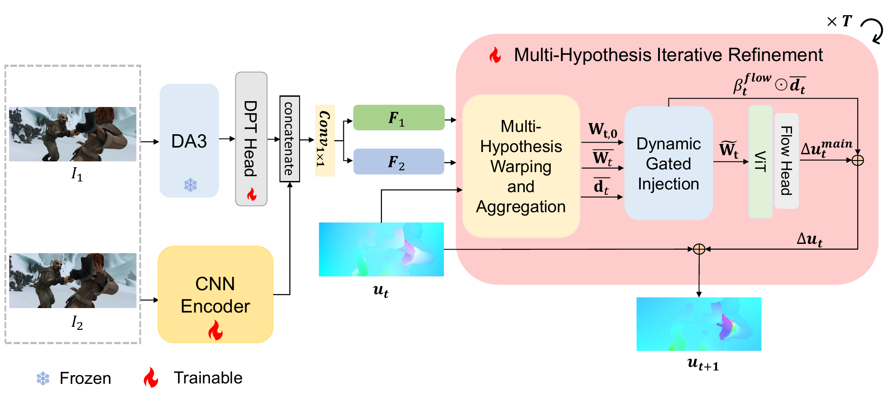

<h1 align="center">MHFlow: Multi-Hypothesis Iterative Refinement for Warping-Alone Optical Flow Estimation</h1>

Yingda Huang · Dong Li

<strong>Code coming soon</strong>

## Introduction

MHFlow estimates optical flow between consecutive frames. It considers nearby candidate matches to refine the flow estimate over multiple iterations.

  

